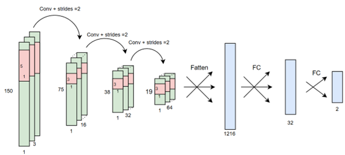
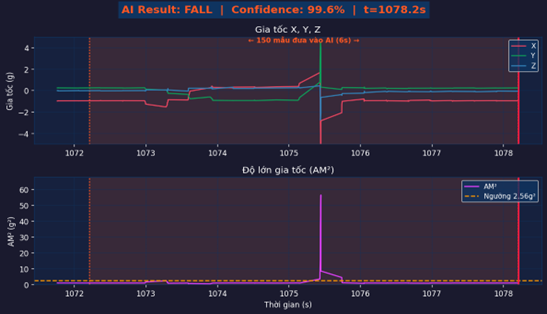
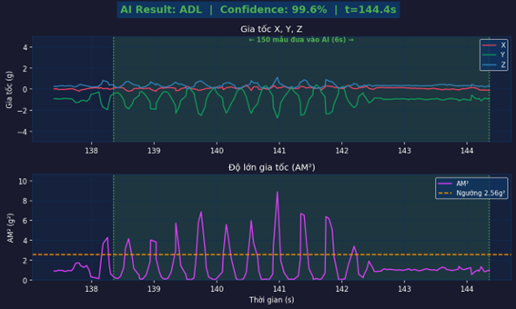
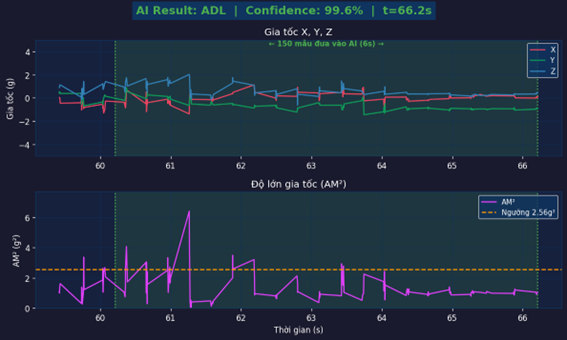
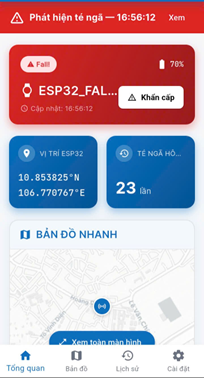
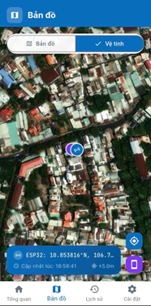
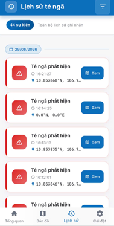
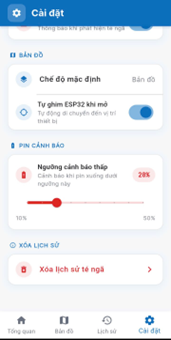
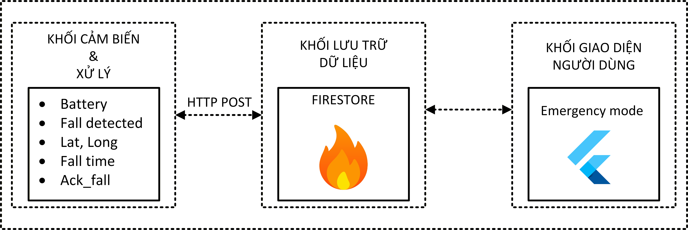

# Thiết bị đeo AIoT nhận diện té ngã tích hợp GPS

Đồ án nhóm hai người xây dựng thiết bị đeo phát hiện té ngã, gửi vị trí GPS và cảnh báo đến ứng dụng Android dành cho người giám hộ. Thiết bị kết hợp cảm biến gia tốc MPU6050 với mô hình CNN chạy trực tiếp trên vi điều khiển để phân biệt té ngã và hoạt động sinh hoạt thường ngày (ADL), sau đó truyền dữ liệu qua module EG800K lên Firebase Firestore. Hệ thống hỗ trợ nút SOS, còi báo có khoảng thời gian cho phép hủy cảnh báo và gửi SMS dự phòng.

*Kết nối giữa thiết bị đeo, định vị vệ tinh, Firestore và ứng dụng Android của người giám hộ.*

## Công nghệ sử dụng

| Thành phần | Công nghệ |
| --- | --- |
| Phần cứng | ESP32-S2, MPU6050, Quectel EG800K tích hợp LTE/GNSS, nút SOS, còi buzzer, nguồn pin Li-Po |
| Firmware | C/C++, ESP-IDF, FreeRTOS, I²C, lệnh AT qua UART, giám sát pin bằng ADC |
| Trí tuệ nhân tạo | CNN tích chập theo thời gian (Conv1D), huấn luyện có xét lượng tử hóa (QAT), TensorFlow Lite Int8, TensorFlow Lite Micro; huấn luyện trên SisFall và đánh giá trên KFall |
| Ứng dụng di động | Flutter, Dart, BLoC/Cubit, GetIt, `flutter_map` |
| Nền tảng đám mây và truyền thông | Firebase Cloud Firestore, Firestore REST API, cơ chế lắng nghe thay đổi dữ liệu, dữ liệu di động và SMS |

## Vai trò và đóng góp cá nhân

**Võ Trung Nguyên — thiết kế và triển khai hệ thống IoT trong nhóm hai người.**

- Thiết kế toàn bộ hệ thống IoT và thực hiện kết nối phần cứng.
- Lập trình firmware IoT, bao gồm xử lý dữ liệu cảm biến, điều khiển hoạt động thiết bị và truyền thông.
- Thiết lập, quản lý Firebase để lưu trữ dữ liệu thiết bị và kết nối với ứng dụng di động.
- Xây dựng ứng dụng Flutter phục vụ giám sát, cảnh báo, hiển thị vị trí và tra cứu lịch sử sự kiện.

Các kết quả dưới đây là kết quả chung của hệ thống do nhóm thực hiện. Phần huấn luyện và đánh giá mô hình không được quy thành đóng góp riêng của cá nhân trong tài liệu này.

## Kết quả

Kết quả được trích từ [báo cáo đồ án (DOCX)](docs/report_%C4%91%E1%BB%93%20%C3%A1n.docx), chủ yếu ở mục 3.6.2 và Chương 4. Các thí nghiệm không được chạy lại trong quá trình biên soạn tài liệu.

### Đánh giá mô hình

Mô hình CNN cuối cùng sử dụng cửa sổ gia tốc ba trục gồm **150 mẫu ở tần số 25 Hz, tương ứng 6 giây**. Theo báo cáo, dữ liệu SisFall được chia theo người tham gia: 26 người cho tập huấn luyện và 12 người cho tập kiểm thử. Bảng dưới đây trình bày kết quả của mô hình CNN cuối cùng, tách biệt với các thử nghiệm Conv2D trước đó trong báo cáo.

| Chỉ số | QAT Float32 — tập kiểm thử SisFall | TensorFlow Lite Int8 — tập kiểm thử SisFall |
| --- | ---: | ---: |
| Độ chính xác tổng thể (Accuracy) | 99,72% | 99,72% |
| Độ chính xác của dự đoán té ngã (Precision) | 99,78% | 99,78% |
| Độ nhạy (Sensitivity) | 99,44% | 99,44% |
| Độ đặc hiệu (Specificity) | 99,88% | 99,88% |
| F1-score | 99,61% | 99,61% |

Báo cáo ghi nhận các chỉ số giữ nguyên đến hai chữ số thập phân sau khi chuyển sang Int8. Trong 5.068 mẫu kiểm thử có 14 mẫu dự đoán sai, gồm 4 trường hợp báo động giả và 10 trường hợp bỏ sót té ngã. Khi đánh giá trên **bộ dữ liệu KFall** độc lập, mô hình Int8 đạt **độ chính xác 87%**, cho thấy hiệu năng giảm khi điều kiện thu thập dữ liệu thay đổi. Đây là kết quả đánh giá trên các bộ dữ liệu, không phải phép đo độ chính xác tổng thể đối với người dùng thực tế.

*Các lớp tích chập theo thời gian, tiếp theo là lớp Flatten và các lớp kết nối đầy đủ, theo mô tả ảnh kiến trúc và báo cáo.*

### Minh chứng hoạt động của thiết bị và ứng dụng

Các ảnh được cung cấp minh họa một trường hợp té ngã được phân loại là FALL và các hoạt động nhảy, đi bộ được phân loại là ADL. **Độ tin cậy 99,6%** hiển thị trên ảnh thuộc về từng dự đoán riêng lẻ, không phải độ chính xác tổng hợp của hệ thống.

| Té ngã | Nhảy tại chỗ | Đi bộ |
| --- | --- | --- |
|  |  |  |

Chương 4 ghi nhận việc cập nhật trạng thái thiết bị và lưu sự kiện trên Firestore, ứng dụng tự động xác nhận qua cờ `ack_fall`, cùng cơ chế SMS dự phòng khi kênh cảnh báo qua ứng dụng hoặc nền tảng đám mây không khả dụng. Cờ xác nhận cho biết ứng dụng đã nhận sự kiện, không chứng minh người giám hộ đã đọc cảnh báo.

| Tổng quan | Bản đồ | Lịch sử sự kiện | Cài đặt |
| --- | --- | --- | --- |
|  |  |  |  |

*Ảnh giao diện Flutter minh họa các chức năng giám sát, không phải kết quả đo hiệu năng định lượng.*

### Định vị và ước tính thời lượng pin

Thử nghiệm GNSS trong báo cáo được thực hiện tại vị trí cố định trong phòng kín, ở độ cao được mô tả là 20 m, sau 10 phút bắt tín hiệu và cập nhật mỗi 15 giây. Trong ba lần đo được liệt kê, vĩ độ dao động 0,000006° và kinh độ dao động 0,000008°; số vệ tinh sử dụng là 12–14, với HDOP từ 0,86 đến 1,03. Các thông số này mô tả kết quả định vị ghi nhận được, không phải sai số vị trí tuyệt đối đã đo.

Thời lượng pin được **ước tính** với pin Li-Po 2.000 mAh, hiệu suất mạch nguồn giả định 85%, dòng điện tham khảo của các linh kiện và thời gian hoạt động từng trạng thái lấy từ log dài 288 giây.

| Kịch bản | Dòng điện trung bình ước tính | Thời lượng pin ước tính |
| --- | ---: | ---: |
| Ít vận động | 106,9 mA | 15,9 giờ |
| Vận động mạnh | 107,9 mA | 15,8 giờ |
| Tải nặng | 129,3 mA | 13,1 giờ |

*Nguồn: Chương 4, phần phân tích công suất tiêu thụ, Bảng 4.4. Đây là kết quả tính toán, chưa phải thời lượng đo bằng thử nghiệm xả pin hoàn chỉnh.*

## Tài liệu phần cứng

*Các khối phần cứng, nguồn cấp, giao tiếp cảm biến, truyền thông di động, Firestore và cảnh báo đến người giám hộ.*

| Linh kiện | Chức năng |
| --- | --- |
| ESP32-S2 | Thu thập dữ liệu cảm biến, suy luận mô hình và điều khiển thiết bị |
| MPU6050 | Thu thập chuyển động qua I²C; gia tốc ba trục được dùng để suy luận |
| Quectel EG800K | Định vị GNSS, truyền dữ liệu LTE và gửi SMS bằng lệnh AT qua UART |
| Nút SOS và còi buzzer | Kích hoạt cảnh báo thủ công, phát âm báo và hỗ trợ hủy cảnh báo tại thiết bị |
| Pin Li-Po 1 cell, 2.000 mAh, điện áp danh định 3,7 V | Nguồn pin được mô tả trong báo cáo |
| TP4056 và XL6009 | Sạc pin và chuyển đổi nguồn DC-DC |
| Hai điện trở 10 kΩ | Chia áp để giám sát điện áp pin bằng ADC |

*Trạng thái thiết bị, sự kiện té ngã, tọa độ và tín hiệu xác nhận được trao đổi qua Firestore; ứng dụng có thể yêu cầu theo dõi khẩn cấp.*

Quy trình nhận diện lưu các mẫu gia tốc vào bộ đệm, phát hiện va chạm khi độ lớn gia tốc bình phương vượt **2,56 g²**, sau đó thu thập thêm 75 mẫu trước khi phân loại toàn bộ cửa sổ. Khi phát hiện té ngã hoặc nhận tín hiệu SOS, thiết bị phát còi trong **5 giây** để người dùng có thể hủy cảnh báo. Báo cáo quy định khoảng chờ **30 giây** giữa các lần cảnh báo. Phần thiết kế phần cứng trong báo cáo có sơ đồ nối chân (Hình 3.4) và mạch đo điện áp pin (Hình 3.9).

## Hướng dẫn chạy

Bắt đầu từ thư mục dự án đã tải về. Chuẩn bị **ESP-IDF**, **Flutter cùng bộ công cụ phát triển Android**, phần cứng đã kết nối, SIM hỗ trợ dữ liệu di động và SMS, cùng một dự án Firebase có Cloud Firestore. Tệp `pubspec.yaml` của ứng dụng yêu cầu Dart `>=3.11.0 <4.0.0`.

1. **Cấu hình Firebase dùng chung.** Sử dụng cùng dự án Firebase và mã thiết bị cho firmware và ứng dụng. Kiểm tra `components/sim_firebase/include/sim_firebase.h` trong firmware, `lib/firebase_options.dart` trong ứng dụng và cấu hình Firebase dành cho Android. Ứng dụng đọc `devices/ESP32_FALL_001` và `fall_events`; thiết lập quyền truy cập Firestore phù hợp với môi trường triển khai và cấu hình số điện thoại nhận SMS của người giám hộ.
2. **Biên dịch và nạp firmware chính.** Mở `sisfall_system-main/sisfall_system-main/fall_detection_system-main/` trong môi trường phát triển ESP-IDF. Kiểm tra cấu hình vi điều khiển và GPIO cho ESP32-S2 theo cách nối phần cứng thực tế, sau đó biên dịch, nạp chương trình và theo dõi cổng nối tiếp bằng ESP-IDF. Dự án có sẵn tệp header chứa mô hình và bảng phân vùng. Hai thư mục cùng cấp `wireless_test/` và `power_test/` phục vụ các thử nghiệm bổ trợ.
3. **Chạy ứng dụng Android.** Mở `healthcare_map/` trong môi trường phát triển Flutter, tải các thư viện khai báo trong `pubspec.yaml`, chọn thiết bị Android và chạy từ `lib/main.dart`.
4. **Theo dõi hệ thống.** Khi thiết bị đã được cấp nguồn và kết nối, kiểm tra trạng thái, mức pin, vị trí và lịch sử sự kiện trên ứng dụng. Có thể dùng nút SOS để kích hoạt luồng cảnh báo thủ công; theo dõi log nối tiếp của firmware khi kiểm tra việc gửi dữ liệu lên Firestore và SMS dự phòng.

Hướng dẫn này được xây dựng từ mã nguồn và báo cáo dự án; các bước chưa được thực thi trong quá trình biên soạn tài liệu.

## Báo cáo

- [Báo cáo PDF](docs/AIoT_sis_fall_report.pdf)
- [Báo cáo DOCX dùng để biên soạn tài liệu này](docs/report_%C4%91%E1%BB%93%20%C3%A1n.docx)

Các báo cáo và ảnh được giữ nguyên tại vị trí ban đầu.
